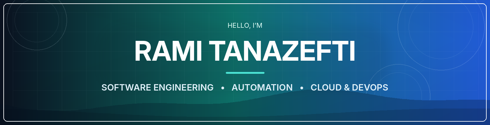
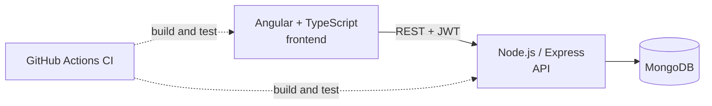
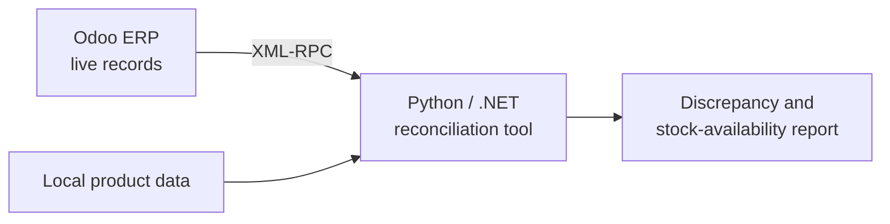

  

  

   

  
  
  

    

  
  

---

## Hi, I'm Rami 👋

Final-year **Teleinformatics Engineering** student at **ISITCOM Sousse**, with a bachelor's degree in Software Engineering.

I like taking an idea all the way from **problem → architecture → code → working product**, especially when the result saves someone time, connects two systems, or makes a messy workflow feel simple.

> **How I work:** build for real people, automate the repetitive parts, keep systems understandable.

| | |
|:--|:--|
| 🔭 **Focus** | Full-stack development · business-process automation · data integration · Cloud & DevOps |
| 🏢 **Most recent role** | Software Engineering Intern at **MKG Concept** (Jun–Aug 2026), Odoo ERP integrations in Python and .NET |
| 🎯 **Looking for** | A **2027 end-of-studies (PFE) internship** in software engineering, full-stack, automation/integration, or Cloud & DevOps |
| 🗣️ **Languages** | Arabic (native) · French (advanced) · English (advanced) |

---

## Featured work

### 📰 [NewsroomOS](https://github.com/NameRami/NewsroomOS): full-stack newsroom workspace

One workspace for editorial teams: **news monitoring, publications, internal messaging, live TV monitoring, user management and AI-assisted features**, built on a clean split between frontend, REST API and database.

`Angular` · `TypeScript` · `Node.js` · `Express` · `MongoDB` · `JWT` · `GitHub Actions`

**[Read the code →](https://github.com/NameRami/NewsroomOS)**

 

<table>
  <tr>
    <td width="50%" valign="top">
      
      <h3>🌍 PressRadar</h3>
      
Real-time news intelligence dashboard: multiple news sources, a 3D WebGL globe, earthquake and NASA event alerts, and a live TV wall. Ships as a single standalone HTML file.

      
<code>JavaScript</code> <code>REST APIs</code> <code>Three.js / WebGL</code>

      <a href="https://namerami.github.io/PressRadar/PressRadar.html"><b>Live demo ↗</b></a> · <a href="https://github.com/NameRami/PressRadar">Source ↗</a>
    </td>
    <td width="50%" valign="top">
      
      <h3>📺 LiveTVTower</h3>
      
Browser-based TV wall that plays up to nine channels at once, with layouts from 1×1 to 3×3, channel discovery and custom stream playlists. Nothing to install.

      
<code>HTML</code> <code>CSS</code> <code>JavaScript</code> <code>HLS</code>

      <a href="https://namerami.github.io/LiveTVTower/LiveTVTower.html"><b>Live demo ↗</b></a> · <a href="https://github.com/NameRami/LiveTVTower">Source ↗</a>
    </td>
  </tr>
</table>

### ☁️ [Azure Infrastructure as Code](https://github.com/NameRami/terraform-ansible-project)

Terraform definitions for **Azure resources, virtual networking, security configuration and virtual machines**, plus an exploration of the Terraform + Ansible automation workflow.

`Terraform` · `Azure` · `HCL` · `Linux` · `Ansible`

### ⚡ Small tools, useful solutions

| Project | What it does | Stack |
|:--|:--|:--|
| 📋 [**ClipSync**](https://github.com/NameRami/ClipSync) | Syncs clipboard and a shared notepad across devices on the same Wi-Fi | Python · WebSockets · Browser UI |
| 📦 [**QuickShare**](https://github.com/NameRami/QuickShare) | Local file sharing through the browser, with drag-and-drop uploads and QR codes | Python · HTTP |
| 🎯 [**SlideRemote**](https://github.com/NameRami/SlideRemote) | Turns any phone browser into a wireless presentation remote for a Windows PC | Python · WebSockets · Automation |

---

## Experience

**Software Engineering Intern, MKG Concept** · Jun–Aug 2026

I built Python and .NET business tools connected to **Odoo ERP** through **XML-RPC**:

- **Inventory reconciliation:** compares live ERP records with local product data to flag discrepancies and stock-availability problems.
- **Sales analytics:** KPI dashboards covering customer activity, loyalty and monthly trends.
- **Documentation:** technical and user documentation for the tools I delivered.

**Earlier:** IT support, networks and IP surveillance at InfoSelect · 3D modeling and simulation for AI-system evaluation at CRMN · custom automation bots for freelance clients · ERP development exposure at SIMSOFT Technologies.

---

## Tech stack

<table>
  <tr>
    <td width="170"><b>Languages</b></td>
    <td></td>
  </tr>
  <tr>
    <td><b>Frontend and mobile</b></td>
    <td></td>
  </tr>
  <tr>
    <td><b>Backend and APIs</b></td>
    <td></td>
  </tr>
  <tr>
    <td><b>Databases</b></td>
    <td></td>
  </tr>
  <tr>
    <td><b>Cloud and DevOps</b></td>
    <td></td>
  </tr>
  <tr>
    <td><b>AI and automation</b></td>
    <td> LLMs and AI agents · LangGraph · n8n · Streamlit · Plotly · YOLOv8</td>
  </tr>
  <tr>
    <td><b>ERP and integration</b></td>
    <td><b>Odoo ERP</b> · <b>XML-RPC</b> · Divalto ERP · SQL Server · REST · WebSockets · JWT · data reconciliation</td>
  </tr>
  <tr>
    <td><b>Tools and self-hosting</b></td>
    <td> UML · Agile/Scrum · Nextcloud · Nginx Proxy Manager · Uptime Kuma · AdGuard · Jellyfin · LAN and routing</td>
  </tr>
</table>

Depth varies by technology: the list mixes professional work, coursework, personal projects and hands-on exploration.

---

## GitHub at a glance

  
  

These cards reflect public repositories only, not everything I have built or used professionally.

---

### Let's build something useful

I'm open to **PFE internship opportunities in 2027** and happy to talk about software engineering, full-stack, automation, and Cloud & DevOps projects.

